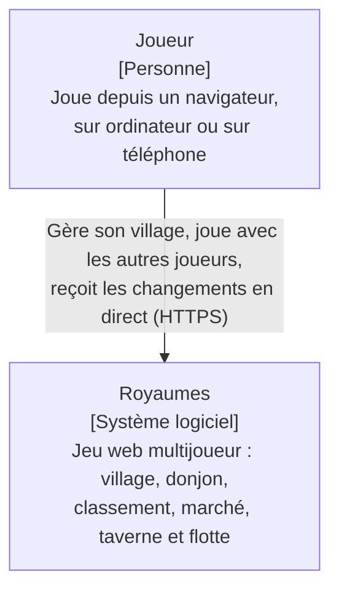
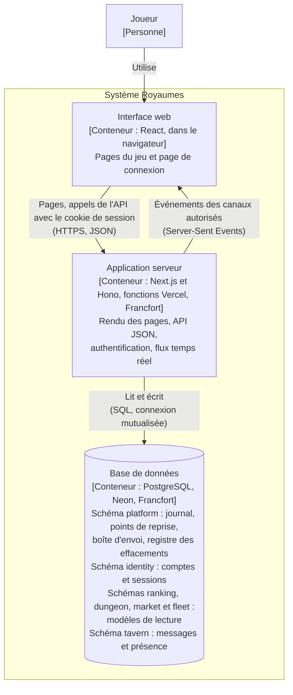
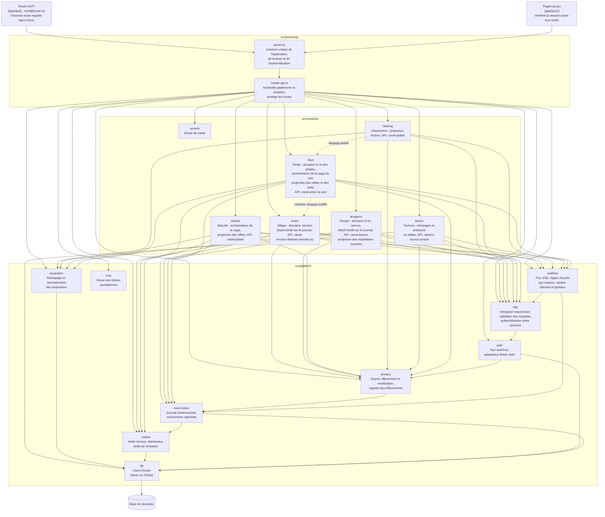
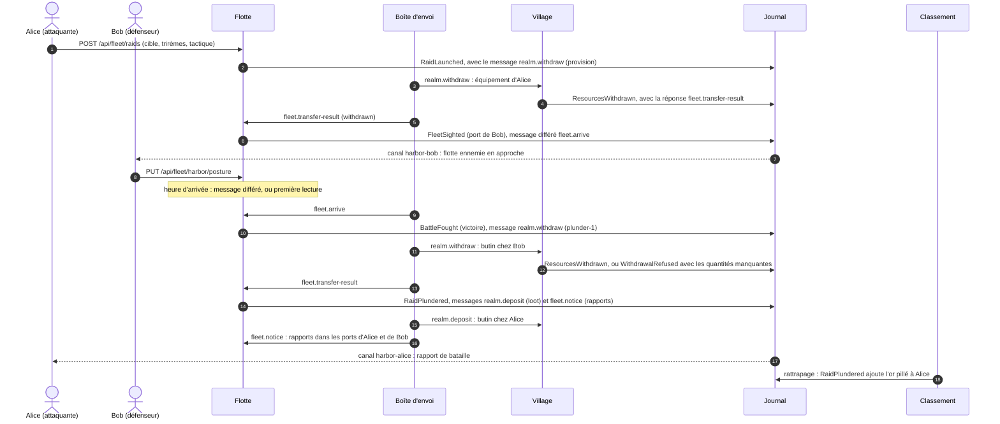
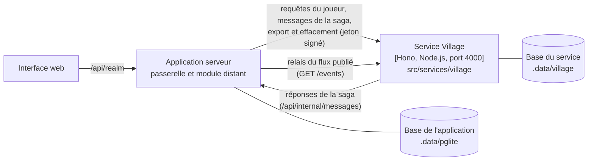
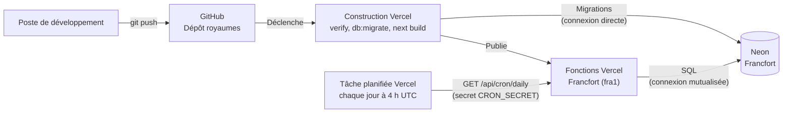

# Architecture de Royaumes

Ce document décrit la structure du système selon le modèle C4, du plus général au plus
détaillé. Les raisons des choix qui y apparaissent sont consignées dans les
[décisions d'architecture](adr/README.md).

Les diagrammes sont rédigés en Mermaid : ils sont versionnés avec le code, et mis à jour
dans le même commit que la modification qu'ils décrivent.

## Niveau 1 - Contexte

Royaumes ne dépend d'aucun système externe : il n'envoie aucun courrier électronique et
ne fait appel à aucun service de paiement ni à aucun fournisseur d'identité. Les comptes
des joueurs sont gérés par le système lui-même.

## Niveau 2 - Conteneurs

| Conteneur | Technologies | Responsabilités |
| --- | --- | --- |
| Interface web | React, composants des modules (`ui.tsx`) | Affichage des vues, envoi des actions du joueur, abonnement aux canaux temps réel |
| Application serveur | Next.js, Hono, Better Auth, Drizzle | Contrôle d'accès, règles du jeu, enregistrement des événements, diffusion des flux |
| Base de données | PostgreSQL (Neon en production, PGlite en local et en test) | Conservation du journal d'événements, des comptes et des sessions ; modèles de lecture des modules |

Le journal d'événements est la seule source de vérité des modules Village, Donjon, Marché et Flotte.
La Taverne n'enregistre pas d'événements : ses tables sont sa propre source de vérité (ADR 0008).
Les tables des schémas `ranking`, `dungeon`, `market` et `fleet` sont des modèles de lecture, dérivés du journal par des projections : elles peuvent
être vidées puis reconstruites à tout moment, sans perte d'information.

L'interface web ne communique jamais directement avec la base : toute lecture et toute
écriture passent par l'application serveur, qui applique le contrôle d'accès.

## Niveau 3 - Composants de l'application serveur

Une flèche pleine signifie « dépend de » ; une flèche en pointillés, « lit le langage publié
ou les contrats de ». Le diagramme ne montre que les dépendances principales :
`server.ts` crée également lui-même la base, le journal et l'adaptateur d'authentification,
qu'il transmet à `create-api.ts`. Les modules `dungeon` et `ranking` écrivent directement
dans leurs propres tables, au sein de la transaction fournie par le moteur des projections.

Le module `ranking` lit des événements du Village et du Donjon, mais n'importe aucun de leurs
fichiers en dehors de leurs contrats : il ne dépend que de leur langage publié, c'est-à-dire
du nom et des données de leurs événements, ainsi que du préfixe de leurs flux.

Le module `market` modifie les villages sans jamais importer le code du Village : il enregistre
des messages dans la boîte d'envoi, que le distributeur remet aux gestionnaires du Village.
La seule dépendance directe porte sur les contrats du Village (`REALM_TOPICS`, `ResourceAmounts`),
qui décrivent ces messages. Chaque transaction ne modifie que les données d'un seul module,
et la boîte d'envoi (ADR 0007).

Le module `fleet` communique avec deux modules existants, sans importer d'autre fichier que
leurs contrats (ADR 0011) :

- avec le **Village**, en écriture, par les messages `realm.withdraw` et `realm.deposit` de la
  boîte d'envoi, comme le Marché : l'équipement d'une flotte est prélevé chez l'attaquant, le
  butin chez le défenseur, puis versé à l'attaquant ; un rappel rend l'équipement. Le Village
  répond sur `fleet.transfer-result`. La saga du raid est décrite par l'ADR 0012 ;
- avec le **Village**, en lecture, par son langage publié : la projection `fleet` lit
  `VillageFounded` et `BuildingUpgraded` pour connaître les cibles et leur défense ;
- avec le **Classement**, qui lit à son tour le langage publié de la Flotte : l'événement
  `RaidPlundered` ajoute l'or pillé à l'or du joueur (projection `ranking`, version 3).

La Flotte s'adresse aussi à elle-même : un message différé `fleet.arrive` déclenche la bataille
à l'heure d'arrivée, et les messages `fleet.notice` déposent les avis dans le flux du port de
chaque joueur, qui est aussi son canal temps réel privé. Ces messages ne portent que des
identifiants : la boîte d'envoi, qui conserve les messages traités, ne contient aucun nom.

Le diagramme suivant présente le parcours d'un raid victorieux contre un village, de son
lancement au classement. Les étapes de la boîte d'envoi sont distribuées après la commande,
ou lors de la lecture suivante ; la bataille a lieu au premier des deux événements entre la
distribution du message différé et la première lecture de la Flotte après l'heure d'arrivée.

Chaque module déclare ses données personnelles à la brique `privacy`, au moyen d'un fichier
`personal-data.ts` : il les exporte, désigne les champs personnels de ses événements, et les
efface de ses tables. La brique `privacy` contient la seule fonction du projet qui modifie un
événement enregistré : la réécriture ciblée des champs personnels, lors de la suppression
d'un compte (ADR 0008) ou de la rectification du nom d'un joueur (ADR 0015).

Les règles suivantes sont vérifiées automatiquement par
dependency-cruiser (`.dependency-cruiser.cjs`) à chaque exécution de `pnpm verify` :

- la plateforme ne dépend d'aucun module ;
- un module n'est accessible que par ses entrées publiques (`index.ts`, `contracts.ts`, `ui.tsx`) ;
- le domaine d'un module ne dépend d'aucune bibliothèque technique ;
- la couche application d'un module ne dépend pas de sa couche infrastructure ;
- le code destiné au navigateur ne dépend d'aucun code serveur ;
- aucune dépendance circulaire n'est admise ;
- un module n'importe jamais les tables de la plateforme : il passe par ses fonctions.

Trois fonctions d'aptitude complètent ces règles, sous la forme de tests
(`src/bootstrap/architecture.test.ts`) : chaque table est rangée dans le schéma d'une brique
de la plateforme ou d'un module ; chaque module qui conserve des données déclare ses
données personnelles ; le domaine de la Flotte ne lit ni l'horloge ni le hasard, condition du
déterminisme des batailles (ADR 0013).

Seule la racine de composition connaît à la fois la plateforme et l'ensemble des modules.

## Extraction du Village

Le Village peut s'exécuter dans un service autonome, distinct de l'application serveur
(ADR 0009). Cette configuration n'est utilisée qu'en local, lorsque les variables
`REALM_SERVICE_URL` et `SERVICE_SECRET` sont définies ; elle n'est pas déployée. Les échanges
portent un jeton signé avec `SERVICE_SECRET`, valable une minute, qui contient l'identité du
joueur : le secret lui-même ne circule plus (ADR 0014).

L'application reçoit alors une version distante du module Village (`remote.ts`), de même
forme que la version exécutée dans le processus : le reste de l'application ne voit pas la
différence. Le relais recopie les événements publiés par le service dans le journal de
l'application, où le Classement et le canal temps réel du village continuent de les lire.
Le service est assemblé par sa propre racine de composition, `src/services/village`, qui
n'utilise le module Village que par son point d'entrée public.

## Niveau 4 - Code

Ce niveau n'est pas dessiné : il est décrit par le code lui-même et par ses tests, que
tout diagramme maintenu à la main ne tarderait pas à contredire.

## Déploiement

Chaque envoi sur la branche `main` déclenche un déploiement. Le code n'est publié que si
l'ensemble des contrôles a réussi, et les migrations ne sont appliquées qu'après ces contrôles.

La tâche planifiée, déclarée dans `vercel.json`, exécute chaque jour les tâches quotidiennes :
la distribution des messages restés en attente dans la boîte d'envoi, et l'application des
durées de conservation de la Taverne. Elle ne s'exécute que sur le déploiement de production.

Le service Village extrait n'est pas déployé : en production, le Village s'exécute dans
les fonctions Vercel, comme les autres modules (ADR 0009).
